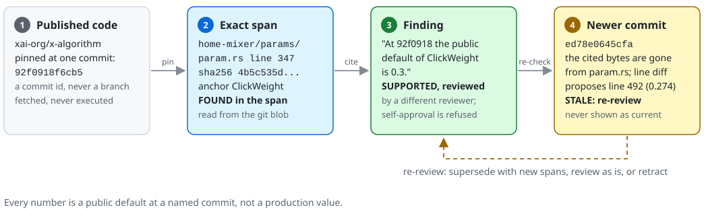
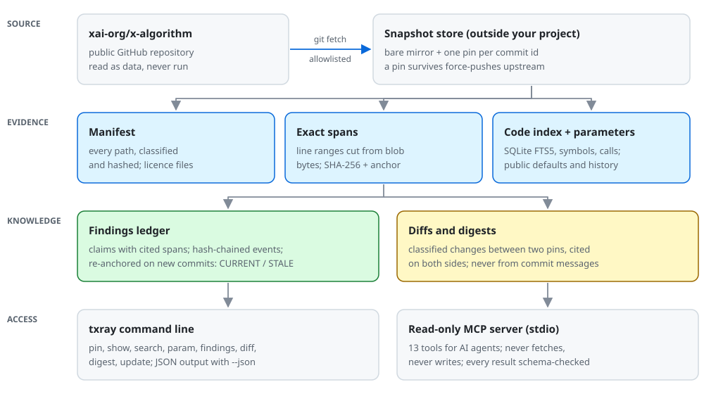

<div align="center">

# TimelineXray

**Read what X's published ranking code actually says, with every claim tied to the exact lines.**

A command-line tool and a read-only MCP server for researchers, journalists, developers and
AI agents who study the open-source recommendation code in
[`xai-org/x-algorithm`](https://github.com/xai-org/x-algorithm).

[](https://github.com/solisolsoli/timelinexray/actions/workflows/ci.yml)
[](LICENSE)
[](pyproject.toml)

[Quick start](#quick-start) · [How it works](#how-it-works) · [Theory and evidence](#theory-and-evidence) · [Documentation](docs/README.md) · [Limits](docs/limits.md)

</div>

Independent community analysis of publicly available source code. Not affiliated with or endorsed by X or xAI.

<picture>
  <source media="(max-width: 700px) and (prefers-color-scheme: dark)" srcset="docs/img/overview-narrow-dark.svg">
  <source media="(max-width: 700px)" srcset="docs/img/overview-narrow-light.svg">
  <source media="(prefers-color-scheme: dark)" srcset="docs/img/overview-dark.svg">
  
</picture>

**The idea in one example.** At commit `92f0918` the published code declares
`ClickWeight` in `home-mixer/params/param.rs` with the public default `0.3` (line 347). A
finding records that and cites those exact bytes. At the newer commit `ed78e06` the line
reads `0.274` (now line 492), so TimelineXray marks the finding `STALE` instead of letting
it quietly stay "true". Someone then re-reads both spans and decides.

## What you can ask it

| Question | Command |
| --- | --- |
| What do these lines say at this commit, exactly? | `txray show` |
| Where is a name defined or mentioned? | `txray search`, `txray symbols` |
| What is the public default of a parameter, and when did it change? | `txray param`, `txray param-history` |
| What changed in the code between two commits? | `txray diff`, `txray digest`, `txray update` |
| Which of my recorded claims still hold at the newest commit? | `txray findings reanchor`, `txray findings stale` |
| Can my AI agent answer with citations instead of guesses? | `txray mcp serve` |

Every answer names its commit. Every number is a **public default at that commit**,
never a production value.

## Quick start

You need Linux or macOS, Python 3.11+ with SQLite FTS5 and git 2.38+; the installer checks
all three first and never edits your shell files.

```sh
curl -fsSL https://raw.githubusercontent.com/solisolsoli/timelinexray/main/install.sh | sh
txray setup        # pins and indexes the tested upstream commit, once
txray show 77d431a home-mixer/params/param.rs --lines 327-331 --anchor ClickWeight
```

The third command prints the lines together with everything needed to check them
(real output):

```console
commit     77d431aabf409ca1c1eed9bec7e2183f7c914e23
path       home-mixer/params/param.rs
lines      327-331 of 980  (bytes 7900-8053, 153 bytes)
blob       d2bad9d35b39ee11e20dcae58ef496ff860e3fed  sha256 47ad9a0b916049681e2a1561c8e418f2fa6f17f0ad00ea017d3cfa3e5de6ce1b
span       sha256 b923bbcbd2ff34ec1c61bfb2f24354d247ef9f77c914c53b092e4a33885fa8e9
endings    lf=5 crlf=0 unterminated=0
class      parsed-candidate (rust)
anchor     FOUND at line 329 (byte 7919)
note       numbers in the output above are public defaults at commit 77d431aabf409ca1c1eed9bec7e2183f7c914e23, not production values
----
    0.07
);
param!(ClickWeight, f64, "rust_home_mixer_click_weight", 0.3);
param!(OpenLinkWeight, f64, "rust_home_mixer_open_link_weight", 0.2);
param!(
```

Anyone can reproduce the span hash with plain git: the bytes of lines 327-331 of that blob
hash to `b923bbcb...`. Other ways to install (`uv`, `pipx`, inspecting the script first) and
uninstalling are in [docs/install.md](docs/install.md).

## How it works

<picture>
  <source media="(max-width: 700px) and (prefers-color-scheme: dark)" srcset="docs/img/pipeline-narrow-dark.svg">
  <source media="(max-width: 700px)" srcset="docs/img/pipeline-narrow-light.svg">
  <source media="(prefers-color-scheme: dark)" srcset="docs/img/pipeline-dark.svg">
  
</picture>

Five ideas carry the whole tool:

- **Commit pinning.** Work happens at a full commit id, never at a branch. A pinned commit
  is protected in a local mirror, so it stays readable even if the upstream history is
  rewritten later.
- **Spans.** A citation is a line range cut from the git blob as raw bytes, with the
  SHA-256 of exactly those bytes and an anchor word that must occur inside them. Nothing is
  reformatted, so a citation means the same thing to everyone.
- **The code index.** Search, declarations and parameter values per commit, built from
  the same blobs (SQLite full-text search; Rust, Scala, Python and Java). It finds things;
  citations still come from the blob.
- **Findings and their life cycle.** A finding is one falsifiable sentence with its
  citations. It starts as a draft, only a *different* reviewer can confirm it, and when a
  newer commit is pinned it is re-checked: `CURRENT` if the cited bytes are still there,
  `STALE` if they changed, `UNVERIFIABLE` if they cannot be placed. Stale findings go to a
  re-review list; nothing is silently updated.
- **A read-only MCP server.** Thirteen tools (`read_span`, `search_code`, `get_param`,
  `param_history`, `verify_claim`, `stale_worklist`, ...) let an AI agent cite instead of
  guess. The server never fetches and never writes.

What it looks like when the code changes under a finding (real output, excerpt; the store holds
`92f0918` and `ed78e06`, pinned with `txray setup --commit <id>`):

```console
$ txray findings add --actor author-1 --component home-mixer --evidence-class PARAM_DEFAULT \
    --status SUPPORTED --title "ClickWeight public default (Home Mixer)" \
    --claim "At 92f0918 the public default of ClickWeight in home-mixer/params/param.rs is 0.3." \
    --cite 92f0918 home-mixer/params/param.rs 347-347 ClickWeight
created    F-edd0332b2ae6  (draft, SUPPORTED (proposed))

$ txray findings review F-edd0332b2ae6 --actor author-1 --role reviewer --status SUPPORTED --rationale "..."
txray: error: no self-approval: author-1 created finding F-edd0332b2ae6 (create); another reviewer must review it

$ txray findings reanchor --latest
target     ed78e0645cfafcd026cfc1fd0da964f630533334
findings   1: STALE 1
F-edd0332b2ae6           STALE         changed 1  citation 1 home-mixer/params/param.rs:347-347@92f0918f6cb5 changed: the cited bytes of lines 347-347 are not in home-mixer/params/param.rs at the target; the line diff aligns them with lines 492-492

$ txray param-history ClickWeight          # excerpt
param!      ClickWeight  home-mixer/params/param.rs
  2026-10-15T00:55:41Z  92f0918f6cb5  present at the start of the line, public default 0.3
  2026-11-20T05:53:35Z  ed78e0645cfa  value changed: public default 0.3 -> 0.274  (old L347 sha256:4b5c535dbf7b2b6a at 92f0918f6cb5; new L492 sha256:edcf89e31c669970)
param!      ClickWeight  vm-ranker/params.rs
  2026-10-15T00:55:41Z  92f0918f6cb5  present at the start of the line, public default 0.3
  current: public default 0.3 at ed78e0645cfa (2 pinned commit(s) with a value)
note        values are public defaults at the cited commits, not production values; computed from pinned commits only (nothing fetched)
```

(The finding was verified and reviewed by `reviewer-1` between the second and third
commands; `txray findings stale` then lists the old span, the aligned candidate at line 492
and the exact commands to supersede, review or retract it.) Note the two declarations: the
published code at `ed78e06` holds `ClickWeight` in two files with two different public
defaults, and TimelineXray keeps them apart instead of guessing which one a request reads.

### Use it from an AI agent

```sh
txray setup --print-mcp-config      # prints the exact `claude mcp add ...` line; edits nothing
```

The printed line looks like
`claude mcp add --transport stdio timelinexray -- /path/to/bin/txray mcp serve --store /path/to/store`;
`--print-mcp-config json` prints an `mcpServers` snippet for other stdio clients. Rules for
agents (answer only from spans they read, abstain on request-time values) are in
[docs/agents/](docs/agents/). Tested client so far: Claude Code; every other client is
listed as untested in the [client matrix](docs/mcp.md#client-matrix).

## What it does not claim

- **It reads published code; it does not observe X's production system.** No live values,
  experiment assignments, model weights, user data or request-time scores are in the
  repository, so none are in TimelineXray. The upstream README (at `77d431a`) says tunable
  values come from a configuration system and that experiments run on a share of traffic;
  that is why every number is labelled a public default at a named commit.
- **No reach prediction and no "algorithm score".** Nothing it computes predicts reach or
  reconstructs a ranking.
- **A matching hash is text identity, not truth.** The tool can show that bytes are
  unchanged; only a reviewer can say that a claim about them is right.
- **Not an X API client, scraper or posting bot.** The only network access is `git fetch`
  from the allowlisted upstream URL. No telemetry.
- **Never runs upstream code and never redistributes it.** Upstream files are fetched at
  runtime into a local store and read as data.
- **Unofficial.** It has no relation to X or xAI. Windows is not supported yet, and the
  parser is lexical (no type resolution). Every known limit is in
  [docs/limits.md](docs/limits.md).

## Commands

| Command | What it does |
| --- | --- |
| `txray setup` | Pin and index a commit once (default: the tested commit), then print next steps and the agent connection line. |
| `txray pin`, `manifest` | Pin a commit by full or short id; list every path with its class, hashes and licence files. |
| `txray show` | Print an exact line span with blob and span SHA-256 and an anchor check (`--raw` for bytes only). |
| `txray index`, `search`, `symbols` | Build the code index of a commit; search lines; list declarations. |
| `txray param`, `param-history` | A parameter's declarations and public default at a commit; its value at every pinned commit. |
| `txray findings ...` | `add`, `verify`, `review`, `reanchor`, `stale`, `supersede`, `retract`, `import`, `export`, `verify-log`. |
| `txray diff`, `digest`, `update` | Classified changes between two pins, cited on both sides; a guarded fetch of the newest head. |
| `txray mcp serve`, `mcp tools` | The read-only MCP server over stdio, and its tool list. |
| `txray metrics` | Optional: descriptive metrics from *your own* analytics export, in a process with the network disabled. |

Every command accepts `--json` for a machine-readable envelope and `--store DIR` for the
snapshot store, except that `txray mcp serve` takes `--store`, `--ledger` and
`--time-budget` but no `--json`, and `txray mcp tools` takes `--json` only. Exit codes: `0`
success, `1` failed or refused, `2` invalid arguments, `3` network access refused by the
allowlist. The full option list of each command is in its document under [docs/](docs/README.md).

## Theory and evidence

For readers who want to know *why* this design, and how well it works. Start at the
[documentation index](docs/README.md), or go straight to a topic:

| Topic | What you will find |
| --- | --- |
| [The evidence model](docs/evidence-model.md) | Why spans and commit pins; the byte-exact citation; what counts as a claim; who may confirm one. |
| [Staleness](docs/staleness.md) | How a cited span is re-located on a newer commit, when a finding becomes `STALE`, and how that is tested. |
| [The change classifier](docs/classifier.md) | How diffs are classified, the five classifier versions, and their measured precision. |
| [Reviewing upstream changes](docs/upstream-reviews.md) | The procedure for a new upstream snapshot, its acceptance goldens, and the two reviews so far. |
| [Evaluation](docs/evaluation.md) | The mechanical release gates and the semantic gate with an AI agent: method, thresholds and every measured run. |
| [Limits](docs/limits.md) | What can and cannot be inferred from published code, and everything else the tool does not do. |

Measured, not asserted: the controlled mutation suite flags 7 of 7 invalidating changes and
0 of 4 harmless ones; the semantic gate (40 reviewed questions answered by an agent through
the MCP tools, scored by rule) passed on 2026-10-07 with precision 30/30 and abstention 9/9,
one run of one model, after three runs that did not pass. Conditions and caveats are in
[docs/evaluation.md](docs/evaluation.md).

## Status

Alpha. The latest release is `v0.11.0` (2026-10-07); `main` adds two reviewed upstream
snapshots (2026-10-15 and 2026-11-21), classifier v5 and tighter MCP tool descriptions,
listed under "Unreleased" in the [CHANGELOG](CHANGELOG.md). The next version is tagged only
after a new live run of the semantic gate. Interfaces may change before 1.0.

## Contributing

```sh
make test   # unittest suite; no test uses the network
make lint   # byte-compile src, tests and scripts; check the CI workflow
make ci     # exactly what CI runs: lint, hygiene, strict tests, build + clean-venv install
```

Tests that need the real upstream read a local clone through a `file://` URL:
`python scripts/fetch_test_upstream.py DIR` makes one, and `TXRAY_TEST_UPSTREAM=DIR` points
the suite at it; without it those tests are skipped, and with it `make ci` fails on any skip.
Start with [CONTRIBUTING.md](CONTRIBUTING.md). Contributor and agent rules, including the
evidence contract, are in [AGENTS.md](AGENTS.md) (identical to `CLAUDE.md`); security
reporting and the threat model are in [SECURITY.md](SECURITY.md).

## Citing

If you use TimelineXray in research or reporting, cite the pinned upstream commit together
with the tool version. GitHub's "Cite this repository" button reads [CITATION.cff](CITATION.cff).

## License

Apache License 2.0 for this project's original code; see [LICENSE](LICENSE) and
[NOTICE](NOTICE). Upstream source is fetched at runtime and remains under its own terms;
the manifest's license inventory records the license and notice files it contains. The
figures in `docs/img/` are this project's own diagrams, generated from
[`docs/img/src/make_figures.py`](docs/img/src/make_figures.py); they use no X or xAI logos.
