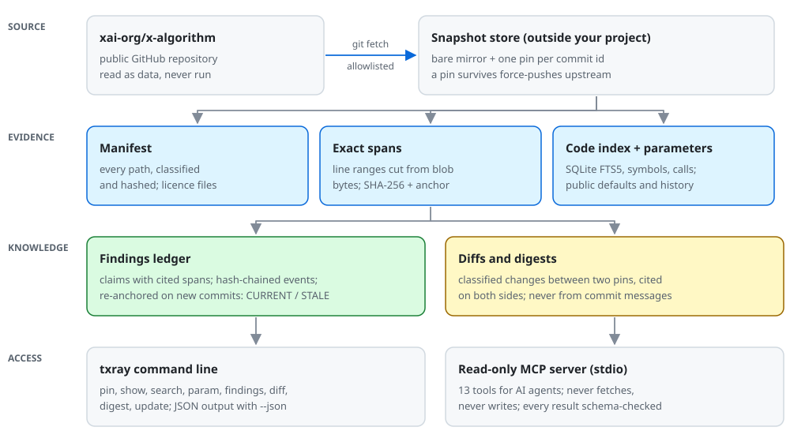

# TimelineXray documentation

TimelineXray reads the public `xai-org/x-algorithm` repository at pinned commits and turns
what the code says into evidence anyone can re-check: exact byte spans, hashes, and
findings that are marked `STALE` when the cited code changes. These pages go from "how do I
use it" to "why is it built this way, and how well does it work".

Independent community analysis of publicly available source code. Not affiliated with or endorsed by X or xAI.

<picture>
  <source media="(max-width: 700px) and (prefers-color-scheme: dark)" srcset="img/pipeline-narrow-dark.svg">
  <source media="(max-width: 700px)" srcset="img/pipeline-narrow-light.svg">
  <source media="(prefers-color-scheme: dark)" srcset="img/pipeline-dark.svg">
  
</picture>

## 1. Start here

| Page | For |
| --- | --- |
| [The project README](../README.md) | What it is, a quick start with real output, the main ideas in five bullets. |
| [Installing](install.md) | The installer and its options, `uv`/`pipx`, uninstalling, troubleshooting. |
| [Agent templates](agents/README.md) | Connecting an AI agent through MCP, and the answer-or-abstain rules R1-R4. |

## 2. How it works

| Page | Content |
| --- | --- |
| [Architecture](architecture.md) | The layers (snapshot store, manifest, spans, index, ledger, MCP, digests), what each may read, the network guard. |
| [Code index](code-index.md) | What is indexed, search, symbols, parameters, call candidates, measured sizes and timings. |
| [Findings memory](findings-memory.md) | The full reference of the ledger: records, events, verification, re-anchoring, review, import. |
| [Updates](updates.md) | `txray diff`, `digest` and `update`: the diff, every class rule, the digest, scheduling. |
| [MCP server](mcp.md) | The thirteen tools, the result envelope, limits, security controls, the client matrix. |

## 3. Theory and evidence

Each page explains one idea from first principles, says how it is implemented (with the
module and the tests), and reports what was measured, with its conditions.

| Page | The question it answers |
| --- | --- |
| [The evidence model](evidence-model.md) | Why a citation is a byte span at a pinned commit; what counts as a claim; why a hash is not truth; who may confirm a finding. |
| [Staleness](staleness.md) | How a cited span is looked for on a newer commit; when a finding is `CURRENT`, `STALE` or `UNVERIFIABLE`; how that is tested. |
| [The change classifier](classifier.md) | How a diff between two commits is sorted into classes; the five classifier versions; measured precision and what it means for a reader. |
| [Reviewing upstream changes](upstream-reviews.md) | The procedure when the upstream publishes new code; acceptance goldens and tests; the 2026-10-15 and 2026-11-21 reviews. |
| [Evaluation](evaluation.md) | The release gates: mechanical integrity and staleness checks, and the semantic gate with an AI agent; every measured run. |
| [Limits](limits.md) | What cannot be inferred from published code, and every other known limit. |

## 4. Records and reference

| Page | Content |
| --- | --- |
| [Upstream review, 2026-10-15](research/upstream-2026-10-15.md) | `78460ca..92f0918`: twelve source changes read in the code, with permalinks. |
| [Upstream review, 2026-11-21](research/upstream-2026-11-21.md) | `92f0918..ed78e06`: twelve source changes, every changed Home Mixer default, the ledger re-review. |
| [Release checklist](release-checklist.md) | The checks of each release and the full record of the semantic gate runs. |
| [Offline metrics](analytics.md) | Optional descriptive metrics from your own analytics export, in a network-disabled process. |
| [Context Layer export](context-layer.md) | Optional export of findings as Markdown notes. |
| [Schemas](../schemas/) | JSON schemas of the CLI envelope, manifests, ledger events and research imports. |

## Figures

The diagrams in [`img/`](img/) are this project's own: plain SVG with real text, a light
and a dark variant each, no scripts, no external references and no X or xAI logos. They are
generated by [`img/src/make_figures.py`](img/src/make_figures.py) (standard library only,
deterministic); `python docs/img/src/make_figures.py --check` fails when a committed figure
differs from the generator, and `tests/test_licensing.py` runs that check. The values shown
in them (commits, lines, hashes, public defaults) were read with `txray show` and
`txray findings` at the named commits.

| Figure | Used in |
| --- | --- |
| `overview`, `overview-narrow` | From published code to a finding that notices change ([README](../README.md); the narrow variant is served below 700 px) |
| `pipeline`, `pipeline-narrow` | The four tiers of the tool (this page, [README](../README.md#how-it-works)) |
| `citation` | Anatomy of a citation ([evidence model](evidence-model.md)) |
| `finding-lifecycle` | The life cycle of a finding ([evidence model](evidence-model.md), [staleness](staleness.md)) |
| `reanchor` | Re-anchoring one span on a newer commit ([staleness](staleness.md)) |
