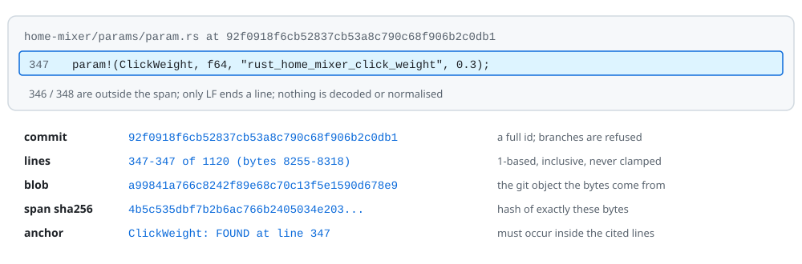
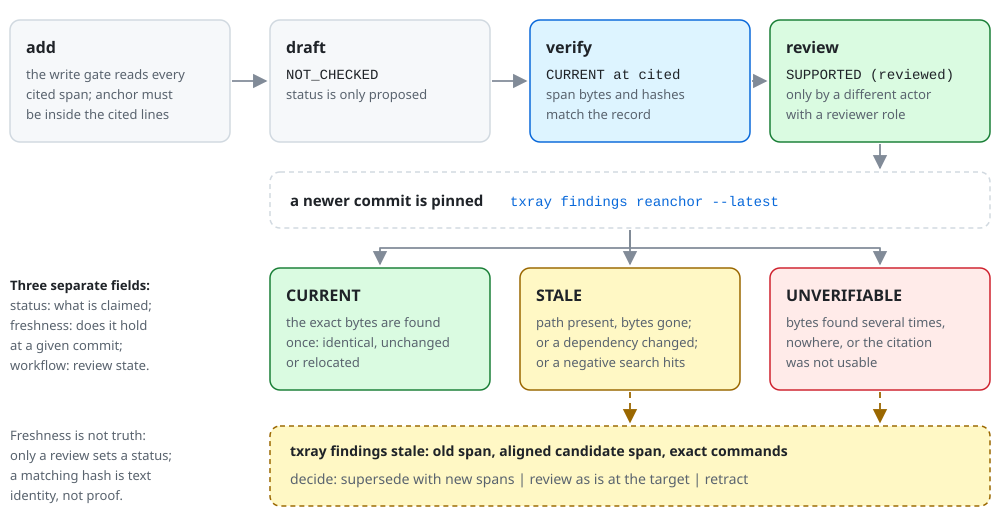

# The evidence model

This page explains what TimelineXray treats as evidence, why, and where each rule is
enforced. The reference with every field and option is [findings-memory.md](findings-memory.md);
the byte-level contracts are in [architecture.md](architecture.md).

## The problem

When a company publishes the code behind its recommendation system, most statements about
that code are made in prose: "the algorithm weights clicks at 0.3". Three things make such a
statement hard to check.

1. **It names no version.** The repository changes; the 2026-11-21 review alone covers 26
   commits and 660 changed files ([upstream review](research/upstream-2026-11-21.md)). A
   sentence that was true at one commit can be false at the next, and nobody notices.
2. **It names no bytes.** A paraphrase or a screenshot cannot be compared mechanically with
   the source, so a reader has to trust the writer.
3. **It confuses code with production.** The upstream README at `77d431a` says that tunable
   values come from a configuration system and that experiments run on a share of traffic.
   A number in the code is a default that may be overridden; the code alone does not say
   what any request used.

TimelineXray answers each point with one rule: name the commit, cite the bytes, and label
every number as a *public default at that commit*.

## A citation is a byte span at a pinned commit

<picture>
  <source media="(prefers-color-scheme: dark)" srcset="img/citation-dark.svg">
  
</picture>

A citation records a full commit id, a path and a 1-based, inclusive line range, plus what
was observed when it was read: the byte range, the blob id, the SHA-256 of the whole blob,
the SHA-256 of exactly the cited bytes, and an anchor verdict.

- **Bytes, not text.** Spans are cut from the blob read with `git cat-file`; nothing is
  decoded, re-indented or normalised. Only LF ends a line, a CR before it stays in the line,
  and a final line without LF counts. A range outside the file is an error, never clamped
  (`timelinexray/span.py`; rules in [architecture.md](architecture.md#byte-to-line-mapping)).
  Because of this, the span hash can be reproduced with plain git: for the README's quick
  start, `git show 77d431a:home-mixer/params/param.rs | sed -n 327,331p | shasum -a 256`
  prints the same `b923bbcb...` that `txray show` reports.
- **An anchor guards the range.** The anchor is a short exact text that must occur inside
  the cited lines: `FOUND` (once), `FOUND_MULTIPLE` (several times, every occurrence
  reported) or `MISSING`. It catches an off-by-some line range, the most common error in
  hand-written citations: two of the reference citations in `goldens/citations.json` keep a
  research report's original, wrong range on purpose, and their anchor is `MISSING`.
- **Pins, not branches.** `txray pin` accepts only hexadecimal commit ids, so a citation can
  never follow a moving branch. A pinned commit gets a protecting ref in the local mirror
  (`refs/txray/pins/<commit>`), so a later fetch after an upstream force-push cannot make it
  unreachable; re-pinning rebuilds the manifest and requires it to be byte-identical
  ([architecture.md](architecture.md#snapshot-store)). Force-push and deleted-commit drills
  are in `tests/test_security.py` and `tests/test_update.py`.
- **The oracle is independent.** The reference citations in `goldens/` were hashed with
  plain `git show` and a byte search, not with TimelineXray, so the tool is tested against
  something it did not produce ([goldens/README.md](../goldens/README.md)).

## What counts as a claim

A **finding** is one falsifiable sentence about the code, with its evidence. The record
keeps four things apart that prose usually mixes:

| Field | Values | Meaning |
| --- | --- | --- |
| evidence class | `CODE`, `PARAM_DEFAULT`, `REPO_DOC`, `OFFICIAL`, `THIRD_PARTY`, `EMPIRICAL`, `INFERENCE` | what kind of source supports it: control flow, a declared default, the repository's own documentation, an outside source, an inference |
| status | `SUPPORTED`, `PARTIAL`, `NOT_FOUND`, `CONTRADICTED`, `EXTERNAL_RECHECK` | what the evidence says about the claim, with a basis: `proposed`, `reported` or `reviewed` |
| freshness | `CURRENT`, `STALE`, `UNVERIFIABLE`, `NOT_CHECKED` | whether the cited evidence still holds at a given commit (see [staleness.md](staleness.md)) |
| workflow | `draft`, `imported`, `reviewed`, `superseded`, `retracted` | where the finding is in review |

A finding also has a **scope**: `public_code`, `public_default`, `historical` or `external`.
There is no production scope, and a `PARAM_DEFAULT` finding always has `public_default`.
`SUPPORTED` with `STALE` is a normal combination: supported by its historical evidence, not
safe to present as current.

A claim that something is **absent** ("no per-head clipping") is a `NOT_FOUND` finding
backed by a recorded search: the query, the path scope, the index generation and the
coverage of what was searchable. Absence is only ever claimed for a stated scope, and the
search is re-run on every newer commit.

## How a claim gets in, and who may confirm it

<picture>
  <source media="(prefers-color-scheme: dark)" srcset="img/finding-lifecycle-dark.svg">
  
</picture>

1. **The write gate.** `txray findings add` reads every cited span from its blob before
   anything is written. The anchor must be inside the cited lines (`MISSING` is refused) and
   an expected `span_sha256`, if given, must match. `CODE`, `PARAM_DEFAULT` and `REPO_DOC`
   claims need a code citation; a `NOT_FOUND` claim needs a negative search with zero hits.
   A new finding is a `draft` whose status is only `proposed`.
2. **Verification is integrity only.** `txray findings verify` re-reads each span:
   `INTACT`, `CHANGED` or `MISSING`, and sets freshness. It never changes a status.
3. **Review by someone else.** Only `txray findings review` sets a reviewed status, only by
   an actor with role `reviewer` or `maintainer`, and never by the finding's author:
   self-approval is refused (`no self-approval: ... another reviewer must review it`).
   Confirming `SUPPORTED` or `PARTIAL` for a finding with code citations also requires a
   current integrity check at the cited commits.
4. **Corrections are new records.** A record is never edited. A correction is a successor
   that supersedes the old finding; a withdrawal is a retraction. Both keep the history.

**A hash is text identity, not truth.** A matching SHA-256 shows that the bytes are the ones
that were cited; it says nothing about whether the sentence describes them correctly. That
is why the verifier only reports integrity, `verify_claim` over MCP always returns
`semantic_verdict: NOT_ASSESSED`, and the only path to `SUPPORTED (reviewed)` is a person
(or agent) other than the author reading the span.

## The ledger

Findings live in an append-only event log (`events.jsonl`) outside any git working tree.
Each event is canonical JSON whose `hash` is the SHA-256 of the event, and whose `prev` is
the previous event's hash. `txray findings verify-log` recomputes the chain and reports a
changed, removed, inserted, reordered or truncated event; every command refuses a log that
fails the check, and replay re-applies the write rules (a self-review in the log fails it).

The limit is stated, not hidden: a hash chain is not a signature. Someone who rewrites the
whole log and its `HEAD` consistently is not detected unless an independently kept head is
compared with `--expect-head`. Actor names are declared, not authenticated; the self-review
rule catches the same declared name approving its own work, it is not an identity system
([findings-memory.md](findings-memory.md#the-event-log)).

## Evidence for agents: answer or abstain

An AI agent using the MCP server follows the same contract, plus four rules for when to
answer at all ([agents/README.md](agents/README.md#answer-or-abstain-rules-r1-r4)):

- **R1** A request-time value (a model's score for a viewer, a rank, reach, an experiment
  assignment, the live state of a switch) is not in the code. Explaining the mechanism is
  not an answer to a question that asks for the value: abstain.
- **R2** A claim that something is suppressed or boosted needs a span that implements
  exactly that rule. A similar name or a related weight supports neither "yes" nor "no".
- **R3** Stop after two unproductive searches in a row, or eight in all.
- **R4** An abstention states its scope: the commit, the searches and their coverage.

How well an agent follows these rules is measured, not assumed: see
[evaluation.md](evaluation.md).

## Where each rule is enforced

| Rule | Code | Tests |
| --- | --- | --- |
| Byte-exact spans, no clamping | `timelinexray/span.py`, `snapshot/` | `tests/test_span.py`, `tests/test_fixture_repo.py` |
| Commit ids only, protected pins, guarded fetch | `snapshot/`, `netguard.py` | `tests/test_netguard.py`, `tests/test_security.py` |
| Write gate, review rules, supersession | `findings/` | `tests/test_findings_ledger.py`, `tests/test_findings_review.py` |
| Hash chain and replay | `findings/` | `tests/test_findings_ledger.py`, `tests/test_security.py` |
| Public-default labelling | `params.py`, `digest/`, `mcp/` | `tests/test_params.py`, `tests/test_digest.py`, `tests/test_mcp.py` |
| Reference citations against the real upstream | `findings/goldens.py` | `tests/test_findings_goldens.py`, `tests/test_upstream*.py` |
| R1-R4 stated in every agent-facing copy | `mcp/server.py`, `docs/agents/` | `tests/test_agent_contract.py` |
